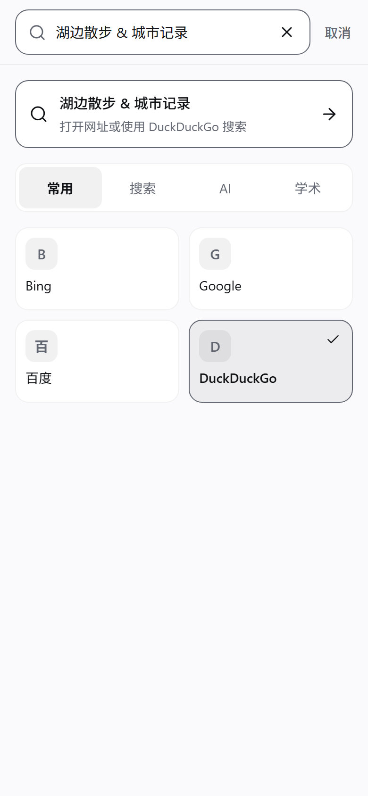
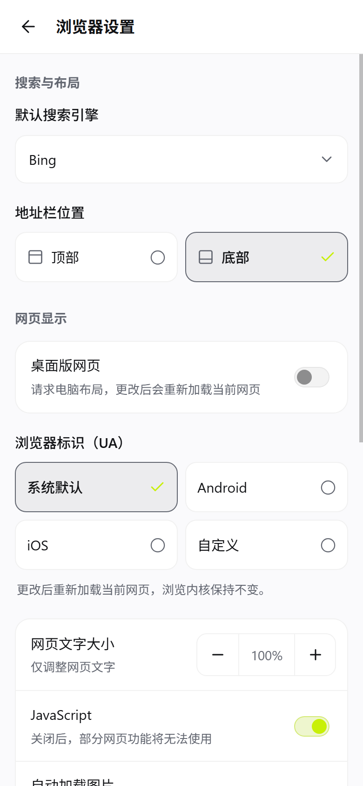
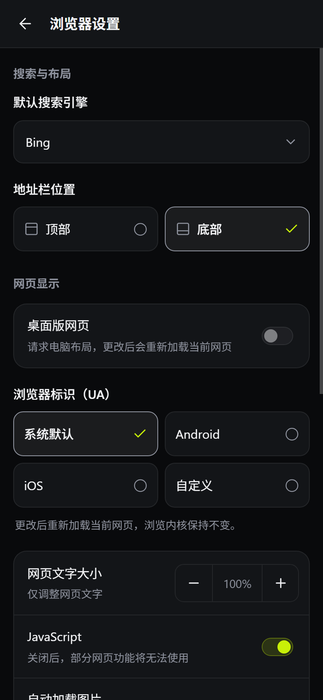
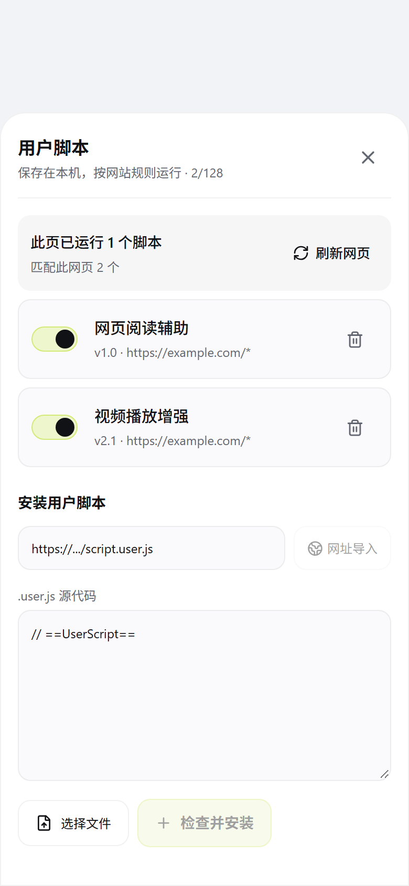
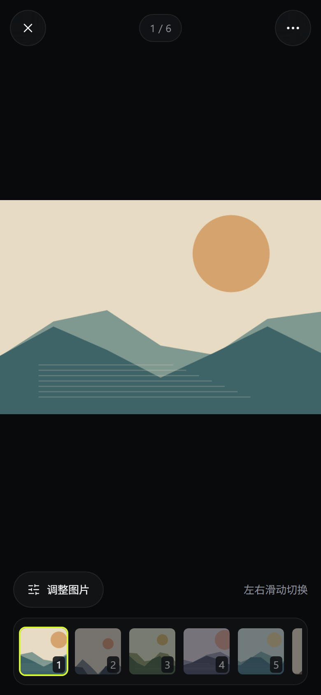
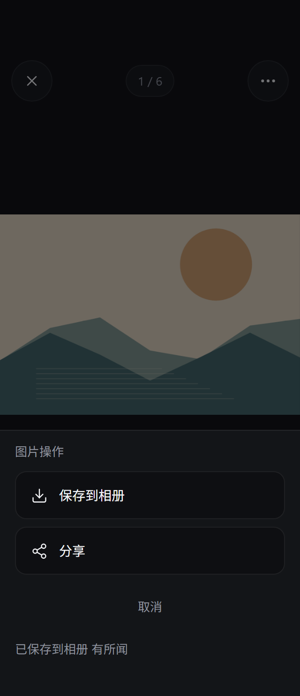

# 内置浏览器交互修正验证报告（2026-10-18）

## 1. 结论与验证范围

本轮本地验证已通过：原生单元测试为 **33 个套件、179 项测试，0 失败、0 错误、0 跳过**；最终前端 gate 完成浏览器测试、TypeScript、相关文件 lint 和生产构建；桌面 Chromium 完成 **83 个视觉状态**与 **12 个定向补验状态**。Android 端在 **API 37、Android 17、x86_64 的模拟器及 Android System WebView 150.0.7871.181** 上验证了同标签隐私开关、重启后的隐私偏好、脚本刷新、UA/viewport 恢复和看图切换。

以下将要求分为六组验收行为。所有“通过”均限定于本文列出的环境和证据，不代表全部 Android 版本、全部机型或物理真机覆盖。

| 验收组 | 本轮结果 | 主要证据 |
|---|---|---|
| 隐私开关与显式保存 | 持久偏好立即停止新增浏览记录；保留当前标签和既有历史；显式书签仍能保存；重启后继续生效；关闭后只记录后续公开导航，不回填私密访问 | [隐私记录与书签](evidence/browser-20261018/privacy-history.json)、[重启](evidence/browser-20261018/privacy-restart.json)、[恢复记录](evidence/browser-20261018/privacy-restored-recording.json) |
| 脚本刷新与计数 | 刷新前提交最新启用脚本；同标签刷新；停用后的完整文档无脚本标记，编辑启用后运行新版本；已运行数来自原生，匹配数按最新本地配置即时计算 | [停用后的文档](evidence/browser-20261018/script-disabled-document.json)、[编辑后的文档](evidence/browser-20261018/script-edited-document.json)、最终 workspace 回归 |
| 桌面模式与身份恢复 | 桌面页面布局宽度为 980 CSS px，Client Hints 为 Linux / mobile=false；退出桌面模式恢复 iOS 或 Android 标识及 426 CSS px 移动布局 | [桌面](evidence/browser-20261018/desktop-document.json)、[恢复 iOS](evidence/browser-20261018/ios-restored-document.json)、[恢复 Android](evidence/browser-20261018/android-document.json) |
| 搜索引擎只选择 | 选择引擎只保存偏好和选中状态，保留输入；提交搜索是独立操作；保存失败、等待期间交互和焦点有回归覆盖 | [83 状态验收](evidence/browser-20261018/browser-ui-verification.json)、最终 product panels / workspace 回归 |
| 看图加载与切换 | fixture 的 8 张图片验证加载、下一张、快速切回及关闭重开；真实网易移动页验证 71 张图片的加载与按钮快速切换 | [fixture 翻页](evidence/browser-20261018/fixture-image-paging.json)、[网易翻页](evidence/browser-20261018/netease-image-paging.json) |
| 界面与交互一致性 | 320 / 390 / 768 CSS px、明暗主题、设置、搜索、脚本、图片及安全区状态通过桌面 Chromium 检查；另补验历史对齐、加载态控件和图片操作图标 | [83 状态矩阵](evidence/browser-20261018/browser-visual-matrix.json)、[12 状态补验](evidence/browser-20261018/browser-visual-fixes-verification.json) |

本文记录本地验证。提交 SHA、远端 CI run、发布产物等由对应 PR 补充；不以历史 CI 结果代替本轮结果。

## 2. 根因、修正与结果

### 2.1 隐私模式改为持久的记录开关

此前实现将隐私模式绑定到独立 Activity / 进程，与本轮“在当前浏览器中开启后停止记录”的要求不符。现在使用 `BrowserPreferences.privateMode`，默认值为 `false`，沿用已有偏好键 `newsnook:browser:preferences:v1`；原生将该值镜像到 `newsnook-native-browser / privacy-enabled`。旧版本缺少此字段时按默认值读取，不删除既有历史、书签或配置。

启用时，Workspace 在等待原生确认前先停止历史写入；原生同步禁止新增历史和恢复快照，并把当前页面标记为不可补记。退出隐私时，不把仍停留在当前文档中的私密访问写回历史。只有新的公开导航才能恢复记录。原生设置应用失败时恢复旧偏好、各标签模式和运行时存储策略，避免 UI 显示隐私开启而原生已进入普通记录模式。

旧独立私密 Activity、启动接口、专用 provider 和入口已移除。仅保留严格限定旧目录的迁移清理；不会为新会话创建独立进程，也不会顺便清除普通 WebView 数据。

设备最终完成状态证明：

- 01:12:13 UTC：当前页 `privateMode=true`、`recordHistory=false`；`historyUnchanged=true`、`explicitBookmarkSaved=true`、`privatePreference=true`。
- 01:16:37 UTC：应用重启后，持久偏好与浏览器界面仍为隐私模式，既有历史保持不变。该记录用于证明偏好恢复，不用其中早期页面状态证明网页已完成加载。
- 01:16:49 UTC：关闭隐私后，原私密页面仍为 `recordHistory=false`；随后访问 `public-after-privacy` 才变为 `true`，并有 `recordingResumesWithoutBackfill=true`。历史中没有私密导航标记。

证据：[隐私记录](evidence/browser-20261018/privacy-history.json)、[重启偏好](evidence/browser-20261018/privacy-restart.json)、[关闭后不回填](evidence/browser-20261018/privacy-restored-recording.json)。实现入口：[BrowserWorkspace](../src/features/browser/BrowserWorkspace.tsx)、[BrowserHostPlugin](../android/app/src/main/java/com/aizeek/newsnook/BrowserHostPlugin.java)。

**保存边界：** 配置、书签、快捷方式以及用户明确执行的保存和下载仍可持久化；隐私开关针对浏览、搜索等自动记录。搜索引擎本身是配置，搜索结果网址则受历史记录规则控制。网站 Cookie、WebStorage 和登录会话继续使用当前系统 WebView 会话；本功能不承诺网络匿名或磁盘物理零写入，也不主动清除已有站点登录。

### 2.2 刷新应用最新脚本，区分“匹配”与“已运行”

原问题有两个层面：刷新没有稳定使用最新脚本绑定；界面将配置数量与当前文档真实执行状态混为一谈。设备上的 WebView 150 已观察到，替换文档开始绑定后单纯 `reload()` 不能可靠安装新绑定，同 URL 的 `loadUrl()` 可以。因此 Host 只在绑定、脚本版本或 UA 等需要新文档时选择同 URL 导航；普通刷新仍保留正常刷新路径。

保存或停用脚本现在只更新快照和版本，不提前关闭当前页面仍在使用的 runtime。下一次导航或刷新再准备新脚本。若慢速 `@require` 准备期间又出现新版本，完成回调重新检查版本，丢弃旧准备结果，再使用最新快照执行待处理导航。

计数分为两个明确含义：

| 显示内容 | 数据来源 | 保存、安装或停用脚本后 |
|---|---|---|
| 此页已运行 N 个脚本 | 原生当前文档确认过的 `started` 消息，按文档和脚本 ID 去重 | 当前文档保留原执行数，刷新后更新 |
| 匹配此网页 N 个 | 最新本地已安装脚本中的 `enabled` 项，结合当前 URL 匹配规则即时计算 | 立即更新，不等待原生 runtime 替换 |

最后的 UI 修正由 `ScriptManager` 本地计算匹配数；native `matchedScriptCount` 是运行时快照，不再作为当前 URL 可用时的即时配置真相。新回归专门覆盖“安装后匹配数变为 1、已运行仍为 0、不自动刷新；停用后匹配数回到 0”。

设备证据使用完整文档状态：

- 01:07:27 UTC：停用并刷新后 `ready=complete`、脚本 port 为 `undefined`、DOM 标记为 `null`。
- 01:07:47 UTC：编辑启用并刷新后 `ready=complete`、port 为 `object`、DOM 标记为 `version-two`。
- 同轮原生状态保留 `tabId=1`；已运行数为真实执行报告，不以安装数代替。初始版本的会话输出不作为本文的独立落盘证据。

证据：[停用后的完整文档](evidence/browser-20261018/script-disabled-document.json)、[新版本完整文档](evidence/browser-20261018/script-edited-document.json)；最终前端日志 `D:\tmp\newsnook-browser-finalfront.log`；[workspace 回归](../scripts/browser-workspace.test.tsx)、[ScriptManager](../src/features/browser/ScriptManager.tsx)、[UserscriptRuntime](../android/app/src/main/java/com/aizeek/newsnook/UserscriptRuntime.java)。

### 2.3 桌面模式同步 UA、Client Hints 和 viewport

此前只改变 UA 或 WebSettings，网站仍可能收到移动身份或保留 `width=device-width`，导致“已选桌面网页但布局未变”。现在 `BrowserPageProfile` 同时管理 UA、支持环境中的 Client Hints 和可恢复的 viewport；桌面脚本也处理网站随后重写 viewport 的情况。

系统与 Android / 桌面预设从当前 WebView 身份派生，Chrome 版本未写死；系统预设保存并恢复原始 metadata。桌面快捷入口与设置页共用持久的 `lastNonDesktopUserAgentMode`，关闭桌面模式后恢复之前选择的移动标识。

以下来自页面 `ready=complete` 的采样，宽度为 CSS 布局宽度，不是模拟器物理像素：

| 页面模式 | 布局宽度 | viewport | Client Hints | 结果 |
|---|---:|---|---|---|
| 桌面 | 980 | `width=980, user-scalable=yes` | `platform=Linux`、`mobile=false`、Chromium / Google Chrome 150 | `desktopLayout=true` |
| 恢复 iOS 预设 | 426 | `width=device-width,initial-scale=1` | `platform=iOS`、`mobile=true`、Safari 26 | `desktopLayout=false` |
| Android 预设 | 426 | `width=device-width,initial-scale=1` | `platform=Android`、`mobile=true`、Chromium / Google Chrome 150 | `desktopLayout=false` |

证据：[桌面 01:08:08 UTC](evidence/browser-20261018/desktop-document.json)、[iOS 恢复 01:08:21 UTC](evidence/browser-20261018/ios-restored-document.json)、[Android 01:10:43 UTC](evidence/browser-20261018/android-document.json)。实现：[BrowserPageProfile](../android/app/src/main/java/com/aizeek/newsnook/BrowserPageProfile.java)、[viewport 脚本](../android/app/src/main/assets/browser-desktop-viewport.js)。

iOS 选项是网站兼容身份预设，实际渲染内核仍为 Android System WebView。上述结果证明本次 fixture 中的身份与布局切换；不能据此保证所有网站都选择相同布局，也不能把较新 provider 的 Client Hints 能力推广到所有旧 WebView。

### 2.4 搜索引擎选择不提交搜索

引擎选择原先与打开动作耦合。现在 Search panel 的选择回调只保存引擎并更新选中态，提交按钮或键盘确认才调用打开动作。搜索入口和设置页使用同一保存函数，搜索提供方来自同一份目录；保存失败不会假装选中成功，保存期间不允许提交到未确定的引擎。

最终 product panels / workspace 回归覆盖选择后不导航、保留查询、偏好恢复、失败回退和等待期间交互。桌面 Chromium 的真实触控输入检查了引擎选择，键盘输入检查默认搜索与焦点；不会把这些桌面输入检查表述为 Android IME 或所有移动输入法兼容性结论。

证据：[Chromium 输入方式及边界](evidence/browser-20261018/browser-ui-verification.json)、最终前端日志；实现：[BrowserSearchPanel](../src/features/browser/BrowserSearchPanel.tsx)、[浏览器偏好](../src/features/browser/browserPreferences.ts)。

### 2.5 看图模式解除缩略图拥塞，验证真实页面与 fixture

大图加载的确定根因是缩略图任务占满并发槽位或队列，主图请求没有及时获得执行机会。现在切入主图窗口会取消不再需要的缩略图任务，优先处理主图及相邻图片；预算拒绝成为可见、可重试的状态。取消后的迟到响应不能覆盖新请求，加载未完成时不开放依赖实际图片的调整控件。

两类设备证据分别记录：

| 来源 | 已验证动作 | 最终观测 |
|---|---|---|
| 自造 fixture，8 张图片 | 主图加载；选择第 2 张；快速选择第 8 张再回第 1 张；关闭回列表后重开 | 主图 1200 × 630，最终 opacity=1；重开为第 1 张；`loadingCleared=true` |
| 真实网站 `https://m.163.com/`，本次共 71 张 | 主图加载；选择第 2 张；快速选择第 3 张再回第 1 张 | 主图 330 × 248；标签 `1 / 71 → 2 / 71 → 1 / 71`；opacity=1；`loadingCleared=true` |

证据：[fixture 01:12:53 UTC](evidence/browser-20261018/fixture-image-paging.json)、[网易 01:14:34 UTC](evidence/browser-20261018/netease-image-paging.json)。网易的快速 `1 → 2 → 3 → 1` 顺序由对应驱动 `D:\tmp\newsnook-browser-corrections-netease-paging.js` 执行，JSON 保存等待完成后的三个检查点。

模拟器注入滑动手势另在 **8 张 fixture** 中通过；本地 `D:\tmp\newsnook-browser-corrections-evidence\netease-open.json` 的 `physicalSwipeAdvanced=true` 对应的是打开网易前的 fixture 手势。它不用于声称网易页面的手势已验收，也不表示物理真机测试。“71 张”是本次网易页面扫描结果，不是对该动态站点的固定数量承诺。

显式保存和分享仍可使用既有导出流程。桌面 Chromium 导出检查走真实导出适配器，但阻止浏览器最终下载；分享桩接收真实 `File` 后模拟用户取消。因此此批证据不能证明 Android 相册写入、系统分享接收方接收成功，或外部应用行为。

### 2.6 视觉、焦点、安全区和加载状态

桌面 Chromium 的基础矩阵覆盖 320 / 390 CSS px 的明暗主题，以及 768 CSS px 平板宽度；检查设置、搜索、脚本、显式历史、快捷方式、图片加载与调整、导出入口。既有键盘焦点、播放器宿主、返回层级及模拟 Android inset 的布局检查同时通过。

随后 12 个定向状态补验了三个具体修正：私密历史说明与输入框的左右对齐；主图加载时保留正确提示并禁用调整；图片操作图标继承当前表面的文字/描边颜色。320 / 390 CSS px、明暗两种主题均覆盖。

| 批次 | UTC 时间 | 状态数 | 结果 |
|---|---|---:|---|
| 桌面 Chromium 基础矩阵 | 01:06:37–01:07:26 | 83 | passed，运行退出码 0 |
| 桌面 Chromium 定向补验 | 01:10:50–01:10:59 | 12 | passed，运行退出码 0 |

证据：[基础验收](evidence/browser-20261018/browser-ui-verification.json)、[基础矩阵](evidence/browser-20261018/browser-visual-matrix.json)、[补验结果](evidence/browser-20261018/browser-visual-fixes-verification.json)、[补验矩阵](evidence/browser-20261018/browser-visual-fixes-matrix.json)。

这两批矩阵合计 95 个已记录状态，不是 95 台设备或 95 项 Android 集成测试。最后的本地即时匹配计数修改晚于矩阵采集，已由最终 workspace 回归、TypeScript / lint / build，以及[最终安装 APK 检查](evidence/browser-20261018/final-smoke.json)实际验证；没有为该修改重新拍摄整套 83+12 状态，具体安装后结果见第 4.3 节。

## 3. 代表截图

以下均为桌面 Chromium 的窄屏布局截图，分别标明 CSS 视口宽度与主题；不作为 Android 模拟器或物理设备截图使用。

| 搜索与设置 | 设置与脚本 |
|---|---|
|  |  |
|  |  |
|  |  |

## 4. 自动化验证记录

### 4.1 最终前端 gate

`D:\tmp\newsnook-browser-finalfront.exit` 为 `0`，对应日志 `D:\tmp\newsnook-browser-finalfront.log` 在 2026-10-18 01:20:49 UTC 完成。runner 按以下顺序执行：

```bat
npm.cmd run test:browser
npx.cmd tsc -b
npx.cmd oxlint --deny-warnings src/features/browser/ScriptManager.tsx src/features/browser/BrowserWorkspace.tsx scripts/browser-workspace.test.tsx
npm.cmd run build
```

`test:browser` 包括 workspace、product panels、preferences、search catalog、desktop viewport、userscript，以及 images / probe / panel / chrome 目标。日志明确记录：

- 持久隐私：同标签、不新增记录、显式书签、重启恢复。
- 脚本刷新：最新启用快照、同标签、真实执行数、同步失败不继续导航。
- 即时匹配数：本地配置立即更新，实际执行等待刷新。
- workspace 生命周期与交互三轮通过。
- 看图队列、取消、重试、主图加载和加载完成后才开放调整的检查通过。

TypeScript 与本次三文件的严格 lint 均为该成功链条中的必要步骤。构建保留既有大 chunk 提示，不把提示表述为构建失败，也未通过降低门槛绕过检查。

### 4.2 原生 gate

对 `android/app/build/test-results/testCloudDebugUnitTest/TEST-*.xml` 逐份累计，结果为：

| 套件数 | tests | failures | errors | skipped |
|---:|---:|---:|---:|---:|
| 33 | 179 | 0 | 0 | 0 |

本轮相关套件包括：

| 套件 | 测试数 | 与本轮直接相关的检查 |
|---|---:|---|
| BrowserHostLifecycleTest | 27 | 设置应用失败回滚、隐私不回填、保留 WebView、刷新脚本、准备期间版本变更、恢复与关闭时序 |
| BrowserImageCaptureLifecycleTest | 6 | 手动扫描、文档代次、取消身份、renderer 退出、读取预算 |
| BrowserMediaCaptureLifecycleTest | 5 | 媒体生命周期与文档切换 |
| BrowserPageProfileTest | 5 | UA 派生、桌面 Client Hints、移动预设、恢复与缩放 |
| BrowserSiteDataLifecycleTest | 14 | 站点清理边界、并发标签、壳站点保护、晚到回调 |
| LegacyPrivateBrowserCleanupTest | 1 | 仅清理旧私密实现拥有的目录 |
| UserscriptPrivacyStorageTest | 2 | 每 runtime 临时值隔离、输入集合不被修改 |
| UserscriptRuntimeLifecycleTest | 13 | 文档身份、真实执行计数、旧写拒绝、存储重置、依赖缓存、关闭及 grant 边界 |

这是原生 JVM / Robolectric 单元测试结果；相关 browser 测试使用 SDK 34 配置，不与 API 37 模拟器运行结果混为一类。XML 时间段中，Host 套件从 01:02:51 UTC 开始，UserscriptRuntime 套件于 01:03:09 UTC 开始。

`D:\tmp\newsnook-browser-native.exit` 为 `0`；日志 `D:\tmp\newsnook-browser-native.log` 记录单元测试、`compileLocalDebugJavaWithJavac` 和审计 APK 构建成功。本轮 native runner 使用既有本地缓存：

```bat
gradlew.bat --offline :app:testCloudDebugUnitTest :app:compileLocalDebugJavaWithJavac --console=plain --max-workers=2
gradlew.bat --offline -I D:/tmp/newsnook-browser-audit.init.gradle :app:assembleCloudDebug --console=plain --max-workers=2
```

以上是已执行记录的整理，编写本报告时没有重新运行构建或设备测试。

### 4.3 最终审计 APK 安装检查

最终审计 APK 安装后，在 `emulator-5554` 上于 **2026-10-18 01:23:22–01:24:32 UTC** 完成检查，归档结果为 `status=passed`。证据：[final-smoke.json](evidence/browser-20261018/final-smoke.json)。

| 身份项 | 归档值 |
|---|---|
| 包名 | `com.aizeek.newsnook.browseraudit.debug` |
| APK 大小 | 8,963,720 bytes |
| APK SHA-256 | `e21c822477f907a472d5938937a662fc66de783e657fc2892e5bf99da523a2ac` |
| 运行环境 | API 37 模拟器，Android System WebView 150.0.7871.181 |
| 应用 PID：开启隐私前 / 隐私中 / 关闭后 | `29836 / 29836 / 29836` |
| 标签身份 | 本次各阶段均为 `tabId=1` |

这份安装后检查覆盖最新前端产物，特别验证本地匹配数即时更新与原生已运行数延后更新的区别：

| 阶段 | 安装后的实际结果 |
|---|---|
| 搜索引擎选择 | 空输入及已输入查询时选择引擎均不提交搜索，查询草稿保留；归档 `searchSelectionOnly=true`、`draftPreserved=true` |
| 开启隐私 | 保持当前网址、标签 1 和应用 PID；`privateMode=true`、`recordHistory=false` |
| 新增匹配脚本，尚未刷新 | UI 显示“匹配此网页 2 个 / 此页已运行 1 个脚本”；原生快照仍为 matched=1、active=1 |
| 刷新当前标签 | 标签仍为 1，原生 active=2；完整文档同时包含原脚本标记 `version-two` 和新增脚本标记 `final-bundle-executed` |
| 删除新增脚本，尚未刷新 | UI 立即变为“匹配此网页 1 个 / 此页已运行 2 个脚本”；原生快照仍为 matched=2、active=2 |
| 再次刷新 | 标签仍为 1，原生 active=1；`ready=complete` 的文档保留 `version-two`，已删除脚本标记为 `null` |
| 关闭隐私 | 应用 PID 仍为 29836，标签仍为 1；当前页面 `privateMode=false` 但 `recordHistory=false`，没有把当前私密文档转为可补记页面 |

进程归档同时给出 `same_application_process=true`。此次结果与第 2.1 节的持久偏好及历史不回填证据相互补充：前者确认最终安装 APK 中的同进程切换，后者确认重启和实际历史内容。没有把此次 fixture 检查扩大为网易手势、相册写入或外部分享接收的验收。

## 5. 独立代码复核与真实边界

本轮独立复核覆盖 `BrowserHostPlugin`、`BrowserPageProfile`、viewport 脚本、`useBrowserSession` / Workspace 接合，以及 UserscriptRuntime 与注入 JS 的协议。发现并修复了以下确定问题：

1. **设置半应用。** 原生先切换持久隐私镜像，随后应用设置失败，可能留下与 UI 不一致的状态。现在回滚原生配置及各标签策略；有一次性故障注入回归。
2. **保存脚本过早替换 runtime。** 当前文档仍在执行旧脚本时，保存动作曾关闭它的 GM 通道并把计数清零。现在保留当前 runtime，导航时才替换。
3. **旧准备结果执行新导航。** 脚本准备期间版本变化，完成回调必须再次核对版本；现在旧结果不能执行待处理导航。
4. **同 URL 旧消息替换通道。** 当前文档的确认身份与待确认启动消息分别管理；迟到的旧文档消息不能改写当前 reply proxy。
5. **延迟执行脚本错过隐私切换。** 首次启动或文档确认时若发现 storage epoch 已变化，补发当前存储状态，避免整份文档长期停留在旧 epoch。
6. **共享站点数据标志残留。** 同进程隐私模式仍共享站点数据，能力结果和清理结果统一返回 `sharedSiteData=true`。

最终回读未发现仍待处理的阻断项。该结论针对已审代码路径；运行通过结论分别来自前述自动化及设备证据。

### GM 首轮同步快照的限制

GM 存储模式切换不是跨 JS/native 的同步事务。一个已经 bootstrap、尚未执行 body 的脚本，发送首次 `started` 后会立即同步执行 body；此时同步 `GM_getValue` 仍可能读到旧 JS 快照，旧 epoch 的 `setValue` / `deleteValue` 会被原生拒绝。收到 `storageReset` 后，后续调用才同步到当前模式。

因此，已验证的语义是：**旧私密写入不能进入普通持久存储，临时值不合并回普通值，晚启动脚本能恢复后续存储调用。** 本文不声称首轮同步 body 原子切换。加入等待 native 确认的握手会改变 `document-start` 执行时序，本轮未作该扩展。

### 本地验证不覆盖的范围

- API 37 设备证据来自模拟器；桌面 Chromium 矩阵使用浏览器与适配器桩，二者均不代表物理真机全覆盖。
- 网易是本次直接访问的真实站点；图片数量及上游内容可变化。fixture 用于稳定验证版本标记、布局、历史标记和切换顺序。
- iOS UA 预设不更换内核；不承诺获得 Safari 的实现行为。
- 浏览器内部显式保存入口保持可用，不把桌面导出适配器通过扩大为外部分享接收或 Android 相册完整验收。
- 历史 native trim 稳定性问题不在本轮宣称的修复范围；没有加入未经证据支持的 WebView 引擎规避代码。

## 6. 证据索引与后续 CI 归档

可随仓库审阅的设备与视觉证据位于 [docs/evidence/browser-20261018](evidence/browser-20261018/)，代表截图位于 [docs/screenshots/browser-20261018](screenshots/browser-20261018/)。[最终安装检查摘要](evidence/browser-20261018/final-smoke.json)单独归档最终审计 APK 的 hash、大小、应用 PID 以及安装后的搜索、隐私、脚本安装/刷新/删除结果。本报告只用完成相应断言的记录支持结论；页面尚未稳定的状态不用于证明布局、脚本执行或图片加载完成。

工作机保留的原始日志：

- 最终前端：`D:\tmp\newsnook-browser-finalfront.log` / `.exit`。
- 原生 gate：`D:\tmp\newsnook-browser-native.log` / `.exit`；原始 XML 为 `android/app/build/test-results/testCloudDebugUnitTest/`。
- Chromium 基础矩阵：`evidence/browser-product-refinement-20261018/browser-ui/browser-ui-run.log` / `.exit`。
- Chromium 定向补验：`evidence/browser-product-refinement-20261018/browser-ui/final-fixes/browser-ui-run.log` / `.exit`。
- Android 操作的完成记录：`D:\tmp\newsnook-browser-corrections-evidence\`，其中本文引用的 10 份完整 JSON 已复制到上述仓库证据目录。

最终审计 APK 的安装检查和产物身份已归档于第 4.3 节。远端 CI 与最终提交身份仍由对应 PR 关联本次源码后补充；本文不预填尚未取得的 run ID、commit 或 CI 成功状态。
